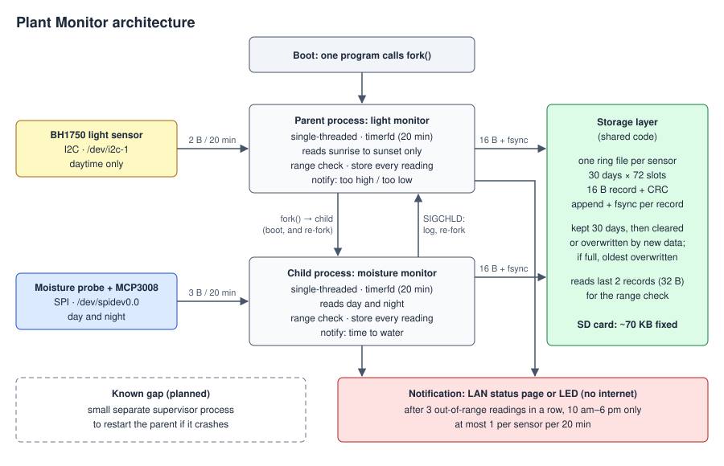

## Architecture

At boot the program calls `fork()`: the parent process becomes the light monitor and the child process becomes the moisture monitor, each single-threaded and sleeping on a 20-minute timer (`timerfd`). When the child's timer fires, it reads the moisture probe over SPI through an MCP3008 ADC (`/dev/spidev0.0`), day or night. If the reading is in the expected range, or out of range while either of the previous 2 readings was in range (treated as a one-off), it is stored. If it is the 3rd out-of-range reading in a row and the time is between 10 am and 6 pm, the child also sends a "time to water" notification to the LAN status page or an LED, never the internet. In every case the value and its time are stored.

| Component | Job | Menu mechanism |
|---|---|---|
| Parent (light monitor) | Reads light over I2C (BH1750, `/dev/i2c-1`) every 20 min during daytime only: between expected sunrise and sunset for the configured time zone, hemisphere, and season (the date may need to be supplied at startup); applies the range / one-off / 3-in-a-row check and notifies "too high" or "too low" 10 am–6 pm; on `SIGCHLD` logs it and re-forks the child | E |
| Child (moisture monitor) | Reads moisture over SPI (MCP3008, `/dev/spidev0.0`), day and night, every 20 min; same check, notifies "time to water" 10 am–6 pm | E (isolated, so a water-damaged sensor can't stop light monitoring) |
| Storage layer (shared code) | One fixed-size ring file per sensor (30 days × 72 slots, 16 B records + CRC); a record is kept for 30 days, then overwritten by waiting data or, if none is waiting, cleared and marked free; if a record must be stored and no slot is free, the oldest is overwritten; append + `fsync` per record; reads the last 2 records for the check | D |

### Data-flow rates

| Flow | Rate / size |
|---|---|
| Sensor reads | Moisture: 1 per 20 min, day and night (72/day, 3 B each). Light: 1 per 20 min, sunrise to sunset only (3 per daylight hour, 2 B each) |
| Storage writes | 1 record (16 B, `fsync` each) per sensor read: moisture 72/day; light 3 per daylight hour |
| Storage reads | Last 2 records (32 B), only when a reading is out of range |
| SD card writes | Moisture 1,152 B/day + light 48 B per daylight hour (e.g. 12 h of daylight → 576 B, ~1.7 KB/day total) |
| SD card footprint | ~70 KB total, fixed (2 rings × 2,160 slots × 16 B) |
| Notifications | At most 1 per sensor per 20 min, 10 am–6 pm only (light only while it is daytime) |
| `fork()` | Once at boot, again whenever the child dies |

**Known gap:** nothing restarts the parent if it crashes; a small separate supervisor process is planned to cover this.

## Mechanism mapping

D: Custom storage layer

Component: the shared storage layer used by both processes. It keeps one fixed-size ring file per sensor (30 days × 72 slots), with 16-byte records that each carry a CRC, and it fsyncs after every record.

Justification: Our alert rule only fires after three out-of-range readings in a row, so every decision depends on the last two stored readings being present and correct. A device sitting on a windowsill gets bumped, unplugged, and power-cycled. If a power cut lost the history, a dry plant’s alert would be delayed by up to another hour. If it left a half-written record that read back as valid, it could send a false “water now,” and a plant owner who waters on a false alarm is overwatering, the exact failure we exist to prevent. That rules out a plain append file, hence a crash-consistent log with a CRC on every record and an fsync after each write. Because the device runs unattended for months, the file is a fixed-size ring: a record is kept for 30 days, then overwritten by waiting data or, if none is waiting, cleared and marked free; if a record must be stored and no slot is free, the oldest is overwritten, so the SD card can never fill.

E: Multi-process architecture with restart

Component: the program fork()s at boot. The parent process monitors light, and the child process monitors moisture. The parent receives SIGCHLD when the child exits, logs it, and forks a new child.

Justification: The moisture probe sits in soil that the owner waters, so it’s the part most likely to short out, return garbage, or hang a read. Sunburn on a windowsill happens within hours, so light monitoring has to keep running when the moisture side fails. If both sensors ran in one process, one bad probe would silence the whole device, and plant owners would keep trusting a monitor that had stopped watching. Hence each sensor gets its own process, and the parent restarts the moisture child automatically, because plant owners aren’t watching a status page waiting to restart it themselves.

Known gap: if the parent itself crashes, nothing restarts it. A small separate supervisor process is planned to close this.

## Failure-mode table

| Component | What fails | How we detect it | What the system does | What the log shows |
|---|---|---|---|---|
| Moisture probe | Unplugged, or shorted by water | ADC reads at a rail (0–5 or 1018–1023) on 3 reads in a row | Store the reading with a fault flag. It is not traeted/counted as a real reading. The status page / LED shows "moisture sensor fault" | `WARN moisture: raw=1023 at rail x3, sensor fault` |
| Light sensor | Unplugged, or I2C error | `read()` on `/dev/i2c-1` fails 3 times (retries 100 ms apart) | Skip this reading, store a fault record, try again in 20 min. Child moisture monitoring is continued | `WARN light: i2c read failed x3 (errno=121), skipped` |
| Child (moisture monitor) | Crashes or is killed | Parent receives `SIGCHLD`; `waitpid()` gives the exit status | Re-fork with backoff (1 s, 2 s, 4 s … max 60 s). Light monitoring keeps running | `ERROR parent: child pid 812 died (signal 9), re-fork #2 in 2 s` |
| Parent (light monitor) | Crashes or is killed | Light readings stop appearing in storage, and the hourly heartbeat lines stop | Light monitoring stops; the child keeps monitoring moisture | No new light readings, and no heartbeat check lines after the crash |
| Storage | Power lost mid-write | On boot, every slot's CRC is checked | A slot with a bad CRC is treated as empty; at most the record being written is lost | `INFO store: light.ring slot 1407 bad CRC, discarded` |
| Storage | SD write fails (`write()`/`fsync()` returns an error) | Return value checked on every call | Keep running; hold the last 2 readings in memory; retry the write next reading | `ERROR store: fsync failed (errno=5), holding in memory` |
| System clock | Wrong clock after power cut | Clock is not equal to returned phone time when notifcations are sent, any power loss | Keep taking and logging measurements, relog and time stamp when new clock is acessed via phone connection | `WARN clock: inaccurate needs correction` |

## Storage and data

**What is stored:** every sensor reading and the time it was taken, in independent light/mositure files.

**Rate:** moisture 1 record every 20 min, day and night (72/day). Light 1 record every 20 min during daylight only (3 per daylight hour). About 1.7 KB/day total.

**Format:** fixed-size 16-byte binary records: sequence number (4 B), timestamp (4 B), reading (2 B), fault flag (1 B), unused (1 B), CRC32 (4 B).

**Retention:** 30 days (72 slots × 30 days per sensor, about 70 KB total, fixed). A record is kept for 30 days, then overwritten by waiting data or, if none is waiting, cleared and marked free; if a record must be stored and no slot is free, the oldest is overwritten. The SD card can never fill.

**Power loss mid-write:** each record is `fsync`ed as soon as it is written. On boot, every record's CRC is checked, and any record with a bad CRC is treated as empty. At most the one record being written when power died is lost.

## Constraints and substitutions

| Ideal | What we're using | What the gap costs |
|---|---|---|
| PAR (quantum) light sensor, about $300, measures the light plants actually use | BH1750 lux sensor, about $3 | Lux measures light the way human eyes see it, not plants. We only claim "brighter or darker than the expected range," not exact plant light |
| Calibrated soil moisture sensor, $100+ | Capacitive probe + MCP3008 ADC, about $8 | Readings are relative and change with soil type and pot. We compare against an expected range, not an absolute moisture level |
| Battery-backed clock (RTC) | No clock battery; time is corrected from the owner's phone | After a power cut, timestamps are wrong until the phone connects, then they are re-stamped |
| Push notifications to the owner's phone from anywhere | LAN status page or an LED on the device | The owner only sees alerts when at home or on the same network |
| Waterproof enclosure | Electronics kept above the soil line | Water can still reach the electronics; probe failures are handled in the failure-mode table |
| Months of real dry-out cycles to test with | A few real cycles, plus recorded data replayed faster | Replayed data is labeled as replayed in logs, the report, and the demo. The 48-hour soak and the demo use live sensors |

**Narrowed claim:** for one plant in one pot, the device alerts when moisture or light has been out of the expected range for 3 readings in a row (40 minutes), between 10 am and 6 pm.

## Evaluation plan

| Measurement | Method | Target |
|---|---|---|
| Read-to-storage time | Timestamp before each sensor read and after its `fsync`, for every reading in the 48-hour soak (~250 readings), once idle and once under `stress-ng` CPU load | 99% under 50 ms, both idle and loaded |
| Notification time | Time from storing the 3rd bad reading to the notification appearing | Under 1 s |
| CPU and memory per process | Hourly heartbeat lines over the 48-hour soak | Each process under 1% CPU; memory grows less than 100 KB over 48 h |
| Domain: dry-out detection | Let the pot dry out 5 times; check the soil by hand every hour and write down when it is dry | "Time to water" within 1 h of the soil being dry by hand, all 5 times; 0 false water alerts |
| Domain: one-off filtering | Shade the light sensor or splash the probe for a single reading, 10 times | 0 notifications |
| Fault: moisture probe unplugged | Unplug it for 1 hour | "Moisture sensor fault" shown; no "time to water"; light keeps working |
| Fault: light sensor unplugged | Unplug it for 1 hour | Readings skipped and logged; moisture keeps working |
| Fault: child killed | `kill -9` the moisture process 10 times | Re-forked every time; 0 light readings missed |
| Fault: parent killed | `kill -9` the light process | Child keeps storing moisture readings; light readings and heartbeats stop |
| Fault: power cut | Pull the power 10 times, including during writes | 0 bad records read back; at most 1 record lost per cut |
| Fault: SD write fails | Make the data file read-only | Error logged; 3-in-a-row check keeps working from memory |
| Fault: clock wrong | Pull the power for 1 hour, then open the status page from a phone | Timestamps corrected; clock warning logged |
| D comparison | Repeat the 10 power cuts with `fsync` turned off | Report bad and lost records with vs without `fsync` |
| E comparison | Run both sensors in one process and crash the moisture side 10 times | Report light readings missed: one process vs two |

## Ownership map

| Partner | Owns |
|---|---|
| Ethan | Light monitor (parent process), `fork()` and child restart (E), light sensor wiring |
| Evan | Moisture monitor (child process), storage layer (D), moisture probe and ADC wiring |
| Shared | Notifications and status page, evaluation runs |

Each partner reviews every change to the other's parts.

## AI-use plan

**What we use Claude Code for:** planning each part before writing it, we plan to work with claude to make these plans. We also expect claude to write the code and implement withn supervison

**What we don't use it for:** anything in the running product. The device makes no AI or cloud calls and contains no pretrained models

**How the boundary is visible in the repo:** the only network code in the product is the LAN status page. No other file opens a network connection. This was no outside calls or connections are made to any AI.